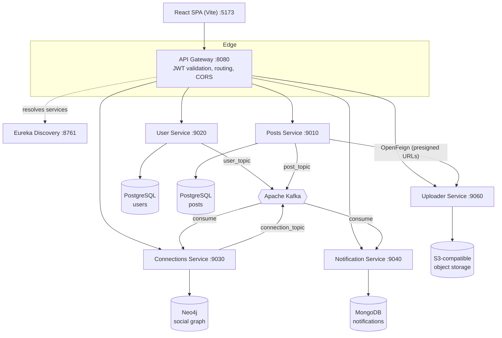
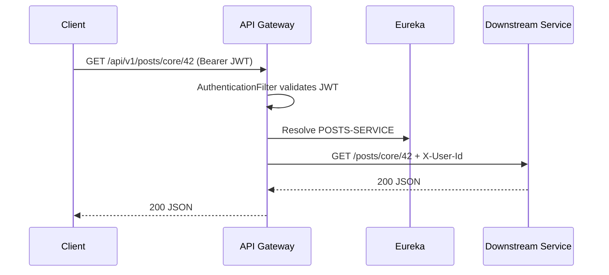
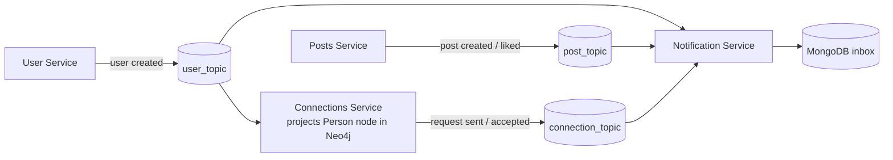

# OrbisIn

A LinkedIn-inspired professional networking platform built as a **polyglot, event-driven microservices system**. Six independently deployable Spring Boot services sit behind a Spring Cloud Gateway, discover each other through Eureka, talk synchronously over OpenFeign, and asynchronously over Apache Kafka. A React SPA consumes the API.

<p align="center">
  
  
  
  
  <br />
  
  
  
  
  <br />
  
  
  
  
  <br />
  
  
  
  
  
</p>

**Core capabilities:** JWT auth, posts with comments and likes, connection requests with a graph-backed network, async notifications, and S3-compatible media uploads.

---

## Table of Contents

1. [Architecture](#architecture)
2. [Design Principles](#design-principles)
3. [Tech Stack](#tech-stack)
4. [Service Catalog](#service-catalog)
5. [Request Flow and Security](#request-flow-and-security)
6. [Event-Driven Communication](#event-driven-communication)
7. [Data Ownership (Polyglot Persistence)](#data-ownership-polyglot-persistence)
8. [Service Deep Dives](#service-deep-dives)
9. [Getting Started](#getting-started)
10. [Configuration](#configuration)
11. [API Reference](#api-reference)
12. [Project Structure](#project-structure)
13. [Known Trade-offs](#known-trade-offs)

---

## Architecture



Reference diagrams live in `.system_design/`:
`OrbisIn_Microserivce_Components.png`, `Microservice_vs_Monolith.png`, `Graph_DB_Query.png`.

## Design Principles

- **Single entry point.** Clients only ever talk to the gateway. Downstream services are never exposed directly.
- **Database per service.** Each service owns its data store; no shared schemas, no cross-service joins.
- **Right database for the job.** Relational for users and posts, graph for connections, document store for notifications, object storage for media.
- **Sync where you need an answer, async where you don't.** Feign for request-time lookups; Kafka for fan-out side effects such as notifications and graph projection.
- **Stateless services.** Identity travels with the request, so every service can be scaled horizontally behind Eureka load balancing.
- **Gateway-enforced authentication.** Services trust a gateway-injected identity header rather than re-validating tokens.

## Tech Stack

| Concern | Technology |
| --- | --- |
| Language / Runtime | Java 21 |
| Framework | Spring Boot 4.x, Spring Cloud 2025.x |
| Gateway | Spring Cloud Gateway (WebFlux) |
| Service Discovery | Netflix Eureka |
| Sync Communication | OpenFeign, client-side load balancing |
| Async Messaging | Apache Kafka (Aiven, SASL_SSL / SCRAM-SHA-256), JSON serialization |
| Persistence | PostgreSQL (Neon), Neo4j AuraDB, MongoDB |
| Object Storage | S3-compatible (AWS SDK v2 + Presigner) |
| Security | JWT (JJWT 0.12.6), BCrypt, gateway `AuthenticationFilter` |
| Observability | Spring Actuator |
| Packaging | Maven, Jib (`eclipse-temurin:21-jre`) |
| Utilities | Lombok, ModelMapper |
| Frontend | React 19 + Vite SPA |

## Service Catalog

| Service | Port | Context Path | Eureka Name | Datastore | Responsibility |
| --- | --- | --- | --- | --- | --- |
| Discovery Server | 8761 | `/` | `discovery-Server` | none | Service registry. Does not register with itself. |
| API Gateway | 8080 | `/api/v1` | `api-gateway` | none | Routing, JWT validation, prefix stripping, CORS, load balancing. |
| User Service | 9020 | `/users` | `user-Service` | PostgreSQL | Signup, login, JWT issuance, identity store. Publishes user events. |
| Posts Service | 9010 | `/posts` | `posts-Service` | PostgreSQL | Posts, comments, likes. Resolves media URLs via Uploader. Publishes post events. |
| Connections Service | 9030 | `/connections` | `connections-Service` | Neo4j | Connection request workflow, first-degree and discovery queries. Consumes user events, publishes connection events. |
| Notification Service | 9040 | `/` | `notificationService` | MongoDB | Async inbox. Consumes all three topics. Read and unread-count endpoints. |
| Uploader Service | 9060 | `/uploads` | `uploaderService` | none | Multipart upload, presigned upload/download URLs, delete, storage health. |
| Frontend | 5173 | `/` | n/a | n/a | React SPA calling the gateway via `VITE_API_BASE`. |

## Request Flow and Security



1. **Login.** `POST /api/v1/users/auth/login` returns a JWT signed with `JWT_SECRET_KEY`.
2. **Gateway validation.** The `AuthenticationFilter` verifies the token on every route except signup and login.
3. **Prefix stripping.** `StripPrefix=2` removes `/api/v1/<resource>` before forwarding, so each service sees only its own context path.
4. **Identity propagation.** The gateway injects `X-User-Id`. Downstream services read it (Posts uses a user-context interceptor) instead of parsing JWTs themselves.
5. **Load-balanced routing.** Routes use `lb://` service names resolved through Eureka.

> The gateway and User Service must share the same `JWT_SECRET_KEY`, otherwise tokens issued at login are rejected.

## Event-Driven Communication

Kafka decouples write paths from side effects. Producers never know who consumes; adding a consumer needs no producer change.

| Topic | Producer | Consumers | Events |
| --- | --- | --- | --- |
| `user_topic` | User Service | Connections, Notification | User created |
| `post_topic` | Posts Service | Notification | Post created, post liked |
| `connection_topic` | Connections Service | Notification | Request sent, request accepted |



- **Serialization:** JSON for all producers and consumers.
- **Consumer group:** the Notification Service uses `notification-service`.
- **Auth to Kafka:** SASL_SSL with SCRAM-SHA-256.

## Data Ownership (Polyglot Persistence)

| Data | Store | Why |
| --- | --- | --- |
| Users, credentials | PostgreSQL | Transactional integrity, unique constraints |
| Posts, comments, likes | PostgreSQL | Relational, strong consistency |
| Connections, requests | Neo4j | Graph traversals (first-degree, discovery) without recursive joins |
| Notifications | MongoDB | Flexible, event-shaped documents, write-heavy inbox |
| Media | S3-compatible storage | Cheap, scalable binary storage |

Services never read each other's databases. When one service needs another's data, it either calls it through Feign or keeps its own projection built from events (as Connections does with users).

## Service Deep Dives

### API Gateway
Built on Spring Cloud Gateway (reactive). Handles CORS for the SPA origin, JWT validation via a custom `AuthenticationFilter`, route-level prefix stripping, and Eureka-backed load balancing. It is the only component clients reach.

### Discovery Server
Eureka registry. All services register by name, which lets the gateway and Feign clients address `lb://SERVICE-NAME` with no hardcoded hosts.

### User Service
Owns identity. Passwords are hashed with BCrypt, and JWTs are issued with JJWT. On signup it publishes a user-created event so other services can react without a synchronous call.

### Posts Service
Owns posts, comments, and likes. For media, it calls the Uploader Service over OpenFeign to resolve presigned download URLs at read time, so storage credentials stay inside one service. It publishes post-created and post-liked events.

### Connections Service
Models the network as a graph in Neo4j. It consumes `user_topic` to project `Person` nodes, then handles the request lifecycle (send, accept, reject, list sent/received) plus first-degree and discovery queries. State transitions publish events to `connection_topic`.

### Notification Service
A pure event consumer with a read API. It subscribes to all three topics, writes notifications into MongoDB, and serves per-recipient lists, unread counts, and mark-as-read.

### Uploader Service
Stateless storage facade over S3-compatible storage. Supports multipart upload (10 MB limit), presigned upload and download URLs (15 minute default expiry), deletion, and a storage health check.

## Getting Started

### Prerequisites

- Java 21, Maven 3.9+, Git
- Node.js 20+ and npm (frontend only)
- Reachable instances (managed or local) of PostgreSQL, Neo4j, MongoDB, Kafka, and an S3-compatible bucket

### Run order

```bash
git clone https://github.com/smitroy4/OrbisIn.git
cd OrbisIn

# 1. Registry first, verify at http://localhost:8761
cd discoveryServer && mvn spring-boot:run

# 2. Backend services (separate terminals)
cd userService && mvn spring-boot:run
cd postsService && mvn spring-boot:run
cd connectionsService && mvn spring-boot:run
cd notificationService && mvn spring-boot:run
cd uploaderService && mvn spring-boot:run

# 3. Gateway last, listens on http://localhost:8080
cd apiGateway && mvn spring-boot:run

# 4. Frontend (optional), http://localhost:5173
cd frontend && npm install && npm run dev
```

## Configuration

Each service loads secrets from a local, uncommitted `.env` via `spring.config.import=optional:file:.env`.

**User Service** (`userService/.env`)
```properties
DB_URL=jdbc:postgresql://<host>/<db>?sslmode=require
DB_USERNAME=<username>
DB_PASSWORD=<password>
JWT_SECRET_KEY=<at-least-256-bit-secret>
KAFKA_BOOTSTRAP_SERVERS=<host:port>
KAFKA_USERNAME=<username>
KAFKA_PASSWORD=<password>
```

**Posts Service** (`postsService/.env`): same keys as User Service.

**Connections Service** (`connectionsService/.env`)
```properties
NEO4J_URI=neo4j+s://<instance>.databases.neo4j.io
NEO4J_USERNAME=<username>
NEO4J_PASSWORD=<password>
KAFKA_BOOTSTRAP_SERVERS=<host:port>
KAFKA_USERNAME=<username>
KAFKA_PASSWORD=<password>
```

**Notification Service** (`notificationService/.env`)
```properties
MONGODB_URI=mongodb+srv://<username>:<password>@<host>/orbisin_notifications
KAFKA_BOOTSTRAP_SERVERS=<host:port>
KAFKA_USERNAME=<username>
KAFKA_PASSWORD=<password>
```

**Uploader Service** (`uploaderService/.env`)
```properties
APP_STORAGE_ENDPOINT=<s3-endpoint>
APP_STORAGE_REGION=<region>
APP_STORAGE_ACCESS_KEY=<key>
APP_STORAGE_SECRET_KEY=<secret>
APP_STORAGE_BUCKET=<bucket>
APP_STORAGE_PUBLIC_BASE_URL=<public-base-url>
```

**API Gateway** (`apiGateway/.env`)
```properties
JWT_SECRET_KEY=<must-match-user-service>
```

**Frontend** (`frontend/.env`)
```properties
VITE_API_BASE=http://localhost:8080
```

## API Reference

Base URL: `http://localhost:8080`. All routes require `Authorization: Bearer <jwt>` except signup and login. A Postman collection is at `.system_design/OrbisIn.postman_collection.json`.

### Users
| Method | Path | Description |
| --- | --- | --- |
| POST | `/api/v1/users/auth/signup` | Register a user |
| POST | `/api/v1/users/auth/login` | Authenticate and receive a JWT |

### Posts
| Method | Path | Description |
| --- | --- | --- |
| POST | `/api/v1/posts/core` | Create a post |
| GET | `/api/v1/posts/core/{postId}` | Get a post |
| GET | `/api/v1/posts/core/users/{userId}/allPosts` | List a user's posts |
| POST | `/api/v1/posts/core/{postId}/comments` | Add a comment |
| GET | `/api/v1/posts/core/{postId}/comments` | List comments |
| DELETE | `/api/v1/posts/core/comments/{commentId}` | Delete a comment |
| POST | `/api/v1/posts/likes/{postId}` | Like a post |
| DELETE | `/api/v1/posts/likes/{postId}` | Unlike a post |

### Connections
| Method | Path | Description |
| --- | --- | --- |
| GET | `/api/v1/connections/core/{userId}/first-degree` | First-degree connections |
| GET | `/api/v1/connections/core/discover` | Suggested connections |
| POST | `/api/v1/connections/core/requests/{receiverId}` | Send a request |
| GET | `/api/v1/connections/core/requests/received` | Received requests |
| GET | `/api/v1/connections/core/requests/sent` | Sent requests |
| POST | `/api/v1/connections/core/requests/{requestId}/accept` | Accept |
| POST | `/api/v1/connections/core/requests/{requestId}/reject` | Reject |

### Notifications
| Method | Path | Description |
| --- | --- | --- |
| GET | `/api/v1/notifications/recipient/{recipientId}` | List notifications |
| GET | `/api/v1/notifications/recipient/{recipientId}/unread-count` | Unread count |
| PATCH | `/api/v1/notifications/{id}/read` | Mark as read |

### Uploads
| Method | Path | Description |
| --- | --- | --- |
| POST | `/api/v1/uploads/core/upload` | Multipart upload (max 10 MB) |
| GET | `/api/v1/uploads/core/presign-upload` | Presigned upload URL |
| GET | `/api/v1/uploads/core/presign-download` | Presigned download URL (also used by Posts Service) |
| DELETE | `/api/v1/uploads/core` | Delete an object |
| GET | `/api/v1/uploads/core/health/storage` | Storage health check |

## Project Structure

```text
OrbisIn/
  apiGateway/            Routes, JWT AuthenticationFilter, CORS
  discoveryServer/       Eureka server
  userService/           Auth, JWT issuance, user events
  postsService/          Posts, comments, likes, Feign clients, user-context interceptor
  connectionsService/    Neo4j entities/repositories, workflows, Kafka consumer/producer
  notificationService/   MongoDB inbox, Kafka consumers, read APIs
  uploaderService/       S3 uploads, presigned URLs, storage health
  frontend/              React + Vite SPA
  .system_design/        Architecture diagrams and Postman collection
```

Each backend service follows the same layering: `controller`, `service`, `entity`, `dto`, `event`, `producer`, `config`.

## Known Trade-offs

- **Shared JWT secret.** Gateway and User Service use a symmetric key. Asymmetric signing (RS256) would let the gateway verify without holding a signing secret.
- **Graph projection lag.** Users created while the Connections consumer is down are missing from Neo4j until the topic is replayed.
- **Eventual consistency.** Notifications and graph nodes are updated asynchronously, so they may briefly trail the source of truth.
- **Build order.** Posts Service depends on User Service artifacts for shared DTOs and events; build User Service first if a multi-module build fails on missing snapshots.
- **Versions.** Java 21 everywhere; Spring Boot 4.0.8 (Notification Service on 4.1.1); Spring Cloud 2025.1.3.